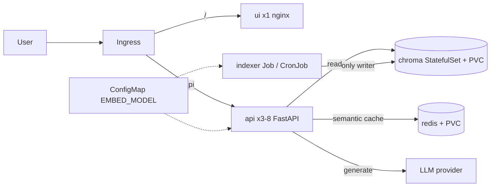

# RAHBAR: grounded question answering on Kubernetes

[](https://github.com/uswa-shafiq-505/Rahbar-RAG-System/actions/workflows/ci.yml)
[](https://github.com/uswa-shafiq-505/Rahbar-RAG-System/actions/workflows/cd.yml)
RAHBAR answers questions **only from a real document corpus** (FAST-NUCES public documents),
cites its sources, and says so when the corpus does not contain the answer. It runs on
Kubernetes: an indexer Job writes a ChromaDB vector store once, and a 3 to 8 replica API only
reads it.



## Requirements
Docker, minikube, kubectl, make, Python 3.12, git. On Windows use WSL 2 (Ubuntu). Ollama on
your laptop with `llama3.2:3b` and `nomic-embed-text` (or a hosted provider key).

## Quick start from a clean clone

```bash
git clone <this repo> && cd rahbar
make install && make test                      # no cluster, no model needed

# 1. Cluster (Calico, because the default CNI silently ignores NetworkPolicy)
make cluster                                   # minikube start --cni=calico + metrics-server + ingress
# 2. Ollama on the host, listening on all interfaces (separate terminal)
OLLAMA_HOST=0.0.0.0 ollama serve
ollama pull llama3.2:3b && ollama pull nomic-embed-text
# 3. Documents: fetch the public corpus (writes corpus/MANIFEST.md), or use the fixtures
make fetch                                     # or: skip, and `make images` stages eval/fixtures
# 4. Images, built locally and loaded into minikube (stages the corpus into the indexer image)
make images
# 5. Manifests, in this order (kustomize applies the namespace first)
kubectl apply -k k8s/overlays/dev              # = make apply
# 6. The LLM key, only for LLM_PROVIDER=hosted
export LLM_API_KEY=...   &&   make secret
# 7. Wait for the indexer Job, then for the api
kubectl wait --for=condition=complete job/indexer -n rahbar --timeout=600s
kubectl rollout status deployment/api -n rahbar
# 8. Reach the Ingress: add "<minikube ip>  rahbar.local" to /etc/hosts
#    (macOS/Windows docker driver: run `minikube tunnel`, use 127.0.0.1)
make ask Q="What is the minimum attendance requirement?"
```

`k8s/overlays/dev` starts in **stub mode** (dummy index, stub LLM) so the cluster can be
proven before the RAG code exists. To run the real pipeline delete the `patches:` block in
`k8s/overlays/dev/kustomization.yaml` and `make apply` again.

## Re-index without a redeploy

```bash
kubectl create job --from=cronjob/reindex manual-reindex-1 -n rahbar
kubectl logs -f job/manual-reindex-1 -n rahbar
```

The api keeps serving from the old index until the new one is in place, and the semantic cache
drops its old answers by itself (ADR 0003).

## API

| Method | Path | Purpose |
|---|---|---|
| POST | `/api/ask` | `{"question": "..."}` (3 to 500 chars) returns a cited answer, or an honest refusal |
| GET | `/healthz` | liveness: the process is alive, touches nothing else |
| GET | `/readyz` | readiness: Chroma reachable, collection non-empty, embedding model matches, Redis reachable (503 otherwise) |
| GET | `/metrics` | Prometheus text format |

## What gets deployed where
- **Your cluster (minikube):** images built locally with `make images`, indexer image contains
  the real corpus from `corpus/raw` (gitignored, fetched by `corpus/fetch.py`).
- **GitHub Actions:** `ci.yml` builds and tests every pull request and runs the eval gate on a
  kind cluster with the fixture corpus. `cd.yml` (push to `main`) tests, pushes images to
  Docker Hub tagged with the commit SHA, then deploys that SHA to an ephemeral kind cluster
  and smoke-tests through the Ingress. There is no `:latest` anywhere.

Corpus: the FAST-NUCES documents are not committed. `corpus/MANIFEST.md` lists each URL and
SHA-256; `corpus/fetch.py` downloads them.

## Security
Namespace `rahbar` with Pod Security `restricted`; per-workload ServiceAccounts with no token;
non-root, read-only root filesystem, all capabilities dropped; deny-by-default NetworkPolicy
(the ui cannot reach Chroma, only the api reaches Redis); Secrets created from the command line,
never committed.

## Repository map and docs
`api/` read-only service, `indexer/` the Job's image, `ui/` static chat page, `k8s/` manifests
(`base/` plus `overlays/{dev,prod,ci}`), `eval/` golden set and gate, `docs/` ADRs, pipeline
report, engineering notes, failure analysis, AI usage. See `docs/ARCHITECTURE.md`.

## Tests and the checker
`make test`, `make lint`, `make check` (submission lint).

## Authors
Member 1 (platform): ... · Member 2 (RAG): ...

 
